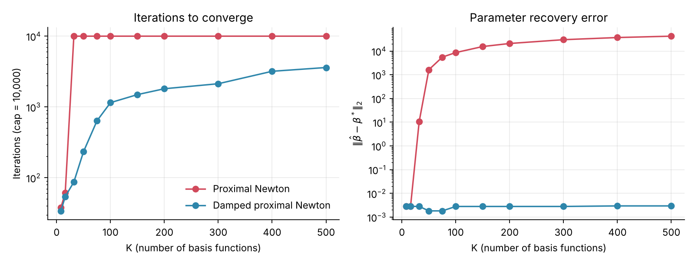

# Accelerating SISTA with Proximal Newton Methods

Research project on **sparse inverse optimal transport**. SISTA (Sinkhorn + ISTA) recovers a sparse cost function from an observed matching. I implemented it from scratch in NumPy, replaced its proximal-gradient step with a **proximal Newton** step and then a **damped proximal Newton** step, and applied all three to real marriage-market data.

## The problem

Given an observed matching $\hat\pi$ between two populations with marginals $p, q$, we look for a cost $C_\beta = \sum_k \beta_k D_k$ (a combination of $K$ candidate basis matrices) whose entropic optimal transport plan reproduces $\hat\pi$. Only a few $\beta_k$ should be nonzero:

$$\min_\beta \; \mathrm{KL}\big(\hat\pi \,\|\, \pi_\beta\big) + \gamma \|\beta\|_1$$

SISTA alternates between a **Sinkhorn** pass, which updates the dual potentials $u, v$ in log-space to enforce the marginals, and a **proximal step on $\beta$**, which applies soft-thresholding to produce sparsity.

## What I implemented

| Variant | $\beta$ update | File |
|---|---|---|
| Proximal gradient (baseline SISTA) | $\beta \leftarrow S_{\rho\gamma}(\beta - \rho\, g)$ | `Chapter_2/sista_algorithm.py` |
| Proximal Newton | Coordinate-wise step $1/H_{kk}$, using the Hessian diagonal $H_{kk} = \mathrm{Var}_\pi(D_k)$ | `Chapter_2/sista_algorithm.py` |
| Damped proximal Newton | Newton direction plus backtracking line search (Armijo condition) | `Chapter_2/damped_newton.py` |

The gradient is $g_k = \langle \hat\pi - \pi, D_k \rangle$. The Hessian diagonal is computed as a variance under the current plan, so it adds only one extra matrix–vector product per iteration. Sinkhorn uses a stable log-sum-exp throughout.

## Key results

**1. Newton converges about 200× faster on well-conditioned problems.** With $K=8$, $N=15$ and a fully converged Sinkhorn step, both methods reach the same objective and recover the same sparsity pattern (5/8 zeros). Proximal gradient needs **5,476 iterations**; proximal Newton needs **25**.

**2. Undamped Newton breaks down as $K$ grows, and damping fixes it.** The full Newton step is only reliable where the quadratic model is accurate. In the sweep below ($N=10$, $\gamma=10^{-4}$, 3 true nonzeros), undamped Newton diverges from $K=32$ onward. The damped variant converges at every size up to $K=500$ and keeps the recovery error near $3\times10^{-3}$.



*Data: `Chapter_2/scaling_K_results.csv`, produced by `Chapter_2/NM_DNM_iterationCVnb.py`.*

**3. Application to marriage matching.** All three solvers are run on real data to identify which features drive who marries whom:
- **Choo & Siow (2006)**: aggregate US marriages across 60 × 60 age groups, with features such as age gap and assortative-matching indicators.
- **Galichon & Dupuy (2014)**: individual-level Big Five personality traits, height, BMI, education and health.

## Repository structure

```
Chapter_1/   Foundations: logistic-regression MLE, OLS vs LASSO, LASSO vs Ridge coefficient paths
Chapter_2/   SISTA: proximal gradient, proximal Newton, damped Newton
             ├── sista_algorithm.py       core algorithms + basic comparison
             ├── damped_newton.py         damped (line-search) variant
             ├── sista_tests.py           controlled experiments, one parameter changed per test
             ├── improved_damped.py       Newton vs damped Newton experiments
             └── NM_DNM_iterationCVnb.py  scaling sweep over K → CSV
Chapter_3/   Application to marriage-market data
             ├── dataset_gen.py                   data extraction and feature construction
             ├── Choo_Siow_age_testing.py         age-based matching
             ├── personality_traits_testing.py    personality and physical traits
             └── mariage_matching_3_models.py     all three solvers compared on real data
```

## Running

```bash
python -m venv .venv && source .venv/bin/activate
pip install -r requirements.txt

cd Chapter_2
python sista_algorithm.py          # proximal gradient vs Newton
python sista_tests.py              # controlled experiments
python NM_DNM_iterationCVnb.py     # scaling sweep → scaling_K_results.csv

cd ../Chapter_3
python mariage_matching_3_models.py   # downloads public data from GitHub on first run
```

## Data sources

- Choo, E. & Siow, A. (2006). *Who Marries Whom and Why.* Journal of Political Economy. Data via [math-econ-code/mec_optim](https://github.com/math-econ-code/mec_optim).
- Dupuy, A. & Galichon, A. (2014). *Personality Traits and the Marriage Market.* Journal of Political Economy. Data via [TraME-Project/TraME-Datasets](https://github.com/TraME-Project/TraME-Datasets).

**Tools:** Python · NumPy · SciPy · pandas · scikit-learn · Plotly
